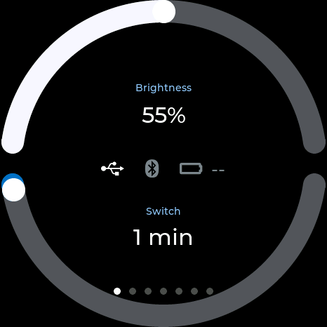
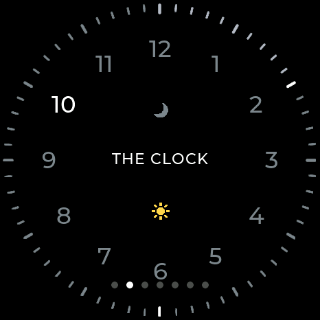
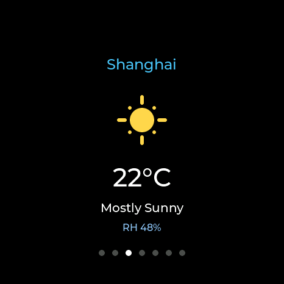
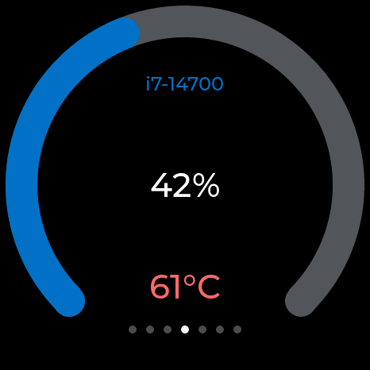
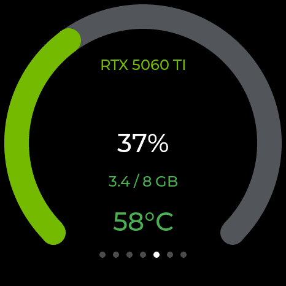
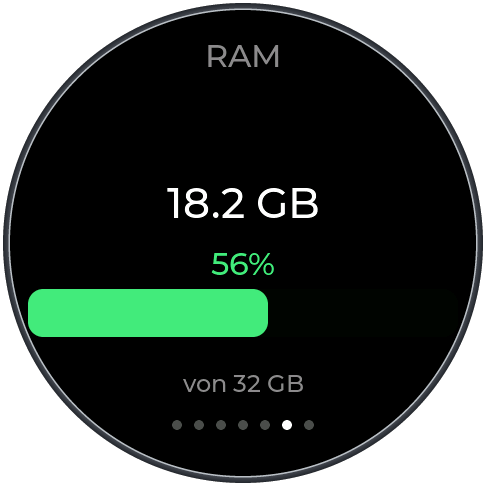
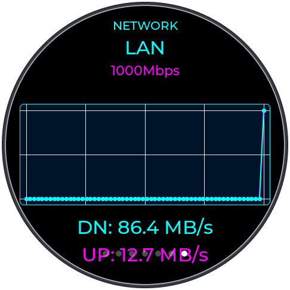

# Scarab Monitor

Real-time PC metrics on a Waveshare ESP32-S3-Touch-AMOLED-1.75C (466×466 CO5300). Swipe between settings, a clock, weather, and CPU, GPU, RAM, and network pages. The PC side is a TrafficMonitor plugin. USB is used when the cable is plugged in; Bluetooth is used when it is not.

## Screens

Swipe left or right. Each picture is the round 466 glass, with the bezel around the circle.

<table>
  <tr>
    <td width="240" align="center"><b>Settings</b><br>Brightness, auto-switch, USB / Bluetooth / battery<br></td>
    <td width="240" align="center"><b>Clock</b><br>Analog face inspired by BALMUDA. The center word is THE CLOCK. Sun and moon follow today's sunrise and sunset<br></td>
    <td width="240" align="center"><b>Weather</b><br>Temperature, condition, humidity<br></td>
  </tr>
  <tr>
    <td width="240" align="center"><b>CPU</b><br>Load and temperature<br></td>
    <td width="240" align="center"><b>GPU</b><br>Load, temperature, VRAM<br></td>
    <td width="240" align="center"><b>RAM</b><br>Used / total<br></td>
  </tr>
  <tr>
    <td width="240" align="center"><b>Network</b><br>Link and live up / down rates<br></td>
    <td width="240"></td>
    <td width="240"></td>
  </tr>
</table>

Settings is not part of the automatic cycle. With auto-switch on, the board walks clock → weather → CPU → GPU → RAM → network → clock. The last page and the switch interval are kept in `/storage`.

The face is inspired by BALMUDA. The word in the center is THE CLOCK. Part of the clock face and its code follows [PC-Monitor](https://github.com/dragoncraft87/PC-Monitor). The clock accepts a new time stamp on the first packet, then once an hour, and also when civil time jumps by 2 seconds or more. The stamp is network time at the weather location (Open-Meteo), not the PC clock. Until the first weather sample, the plugin sends the PC's local time. Until sunrise and sunset are known, day and night fall back to 06:00–18:00.

## Connection

| Path | When it is used |
|------|-----------------|
| USB Serial/JTAG | The ESP32 USB device (VID `303A`, PID `1001`) is present. This path wins if both are up. |
| Bluetooth LE | The cable is unplugged. The board must be on battery. The name is `ESP32Monitor`. |

Bluetooth is BLE only (no classic SPP, no new COM port). The first pair shows a 6-digit code on the glass for 30 seconds; type it on the PC. The bond is stored in NVS, so it survives the reset that happens when the USB serial port is opened. After that, switching between USB and Bluetooth does not ask for the code again.

A board that was paired before NVS persistence was enabled has to be deleted in Windows and paired once more. That first password is the one that gets stored.

## Communication protocol

USB is 115200 8N1. Bluetooth uses the Nordic UART service (`6E400001-B5A3-F393-E0A9-E50E24DCCA9E`). The text lines are the same on both.

### Handshake

USB accepts this immediately:

```
PC    → ESP32:  WHO_ARE_YOU?
ESP32 → PC:     SCARAB_CLIENT_OK|H:<identity-hash>|V:<fw-version>|N:<name>
```

On Bluetooth the board ignores lines until the link is encrypted. It then notifies `BLE_OK:<8 hex chars>`. The plugin sends that token back, then `WHO_ARE_YOU?`.

### Sample line

ASCII, one line, newline-terminated:

```
CPU:<load>,CPUT:<temp>,GPU:<load>,GPUT:<temp>,VRAM:<used>/<total>,RAM:<used>/<total>,NET:<type>,SPEED:<speed>,DOWN:<mbps>,UP:<mbps>,WTEMP:<c>,WCODE:<code>,WHUM:<pct>,WCITY:<name>,SRISE:<min>,SSET:<min>,CLK:<yyyy-mm-ddThh:mm:ss>
```

`-1` means the sensor is unavailable. `SRISE` and `SSET` are minutes from midnight at the weather location, or `-1` until known. `PC_SCREEN:0` and `PC_SCREEN:1` blank and wake the panel with the PC monitor.

Weather location is the Windows location when it is within 20 km, otherwise ipwho.is. Sunrise and sunset come from Open-Meteo.

### Firmware update over USB

The companion app can push a `.bin` over the serial link (Settings → Firmware). The image is written to the inactive OTA slot and checked before the boot partition changes. A failed transfer leaves the running firmware in place.

```
PC    → ESP32:  FW_BEGIN:<size>
ESP32 → PC:     FW_OK:BEGIN
PC    → ESP32:  FW_DATA:<offset>:<hex>
ESP32 → PC:     FW_OK:DATA:<received>
PC    → ESP32:  FW_END:<crc32>
ESP32 → PC:     FW_OK:COMPLETE
```

Boards flashed before the OTA partition table need one cable flash (`idf.py flash`). Later updates can use the serial protocol.

## Hardware

| Component | Specification |
|-----------|---------------|
| Board | [Waveshare ESP32-S3-Touch-AMOLED-1.75C](https://docs.waveshare.net/ESP32-S3-Touch-AMOLED-1.75C/) |
| MCU | ESP32-S3R8, 8 MB octal PSRAM, 32 MB flash |
| Display | 1.75" 466×466 AMOLED, CO5300, QSPI |
| Touch | CST9217 (I2C) |
| Power | AXP2101, USB-C, optional battery |
| Link | USB Serial/JTAG, or Bluetooth LE |

QSPI D0–D3 are GPIO4–7, clock GPIO38, CS GPIO12, LCD reset GPIO1. Touch reset is GPIO2, interrupt GPIO11. I2C is SDA GPIO15, SCL GPIO14. Leave those pins alone. Pin and power notes are in [docs/HARDWARE.md](docs/HARDWARE.md).

## Build

ESP-IDF 5.5 or newer.

```bash
idf.py set-target esp32s3
idf.py build
idf.py -p COM3 flash
```

`set-target` is only needed the first time. Do not use `idf.py monitor` against this port if a flash is about to start; opening the USB-JTAG port resets the chip.

### TrafficMonitor plugin

The plugin project is `TrafficMonitorPlugin/` (`Esp32Bridge.cpp`, `BleClient.cpp`, `WeatherClient.cpp`). It runs inside [TrafficMonitor](https://github.com/zhongyang219/TrafficMonitor). Build `Esp32Monitor.dll` with MSVC (C++17) and place it at:

```
C:\Program Files\TrafficMonitor\plugins\Esp32Monitor.dll
```

TrafficMonitor loads plugins from that folder. Leave its `config.ini` unchanged. Start TrafficMonitor elevated so CPU temperature can be read. USB is used when the ESP32 USB device is present; Bluetooth is used when the cable is unplugged.

The older tray client is still in `PCMonitorClient/` (`.NET Framework 4.7.2`):

```powershell
cd PCMonitorClient
dotnet build -c Release
```

## Project structure

```
ESP32Monitor/
├── main/                         # ESP32 firmware
│   ├── main_lvgl.c               # Pages, swipe, blanking
│   ├── screens/                  # Clock, weather, CPU, GPU, RAM, network
│   └── drivers/                  # Display, USB, BLE, power
├── TrafficMonitorPlugin/         # Windows plugin (USB, BLE, weather)
├── PCMonitorClient/              # Older tray client
├── docs/
│   ├── HARDWARE.md
│   └── SOFTWARE.md
├── CMakeLists.txt
└── partitions.csv                # Two 6 MB app slots + LittleFS
```

## License

MIT License. See [LICENSE](LICENSE).
